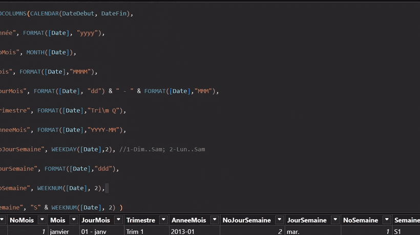
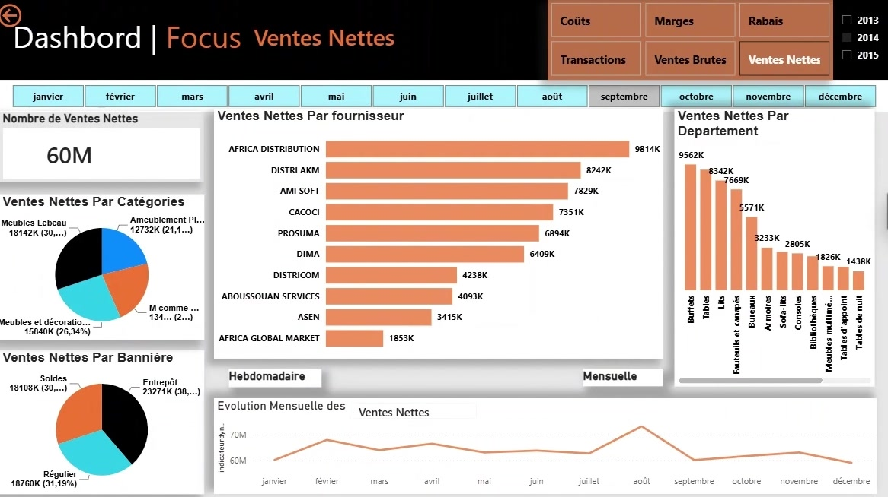
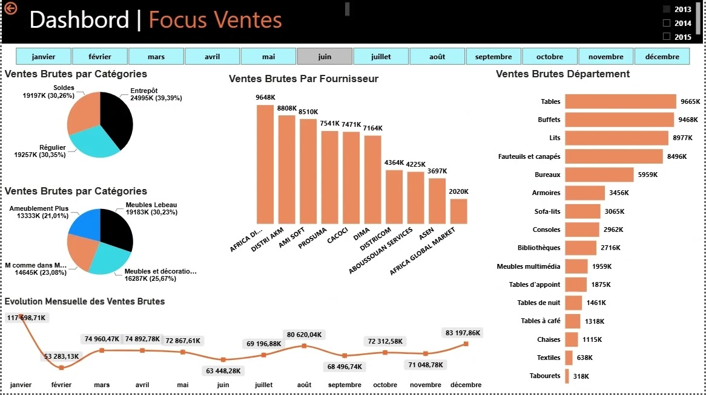
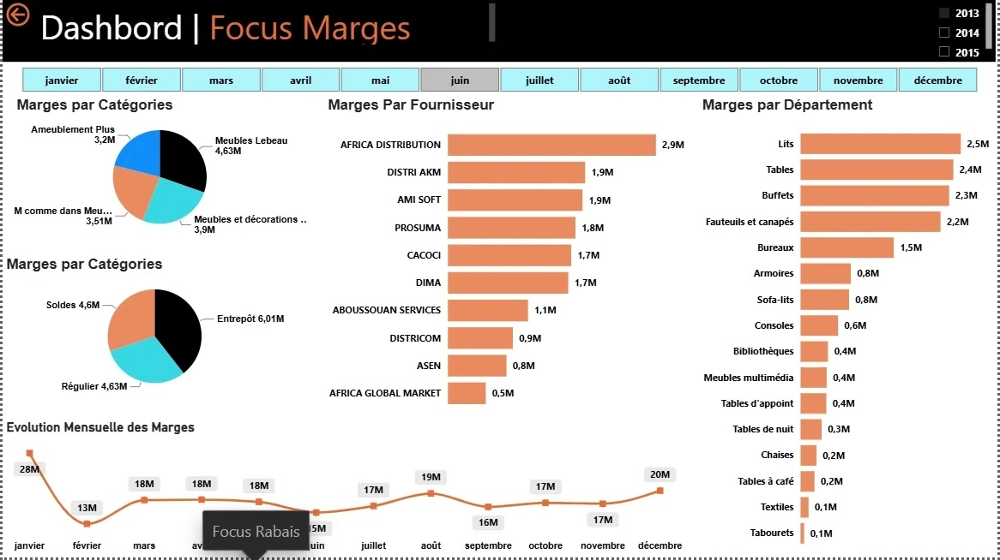
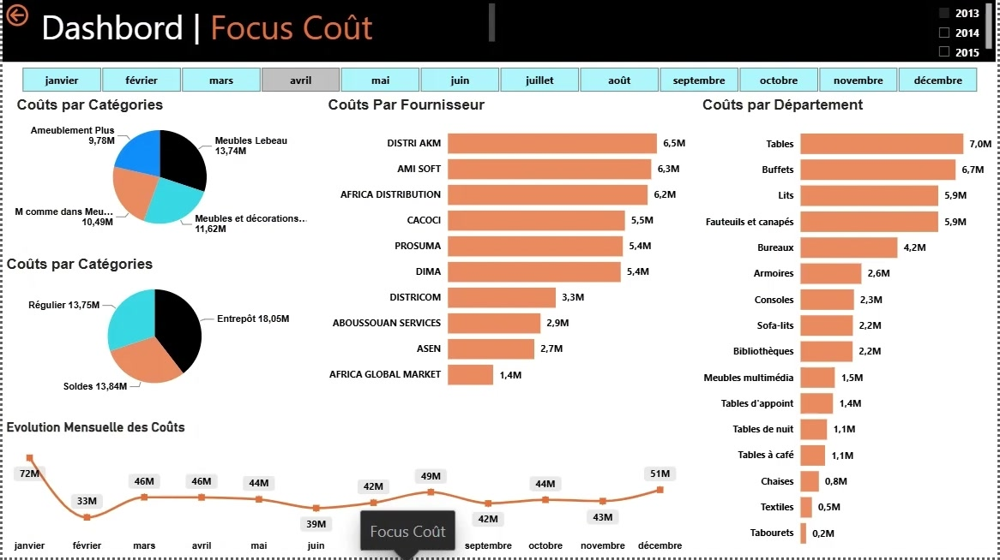
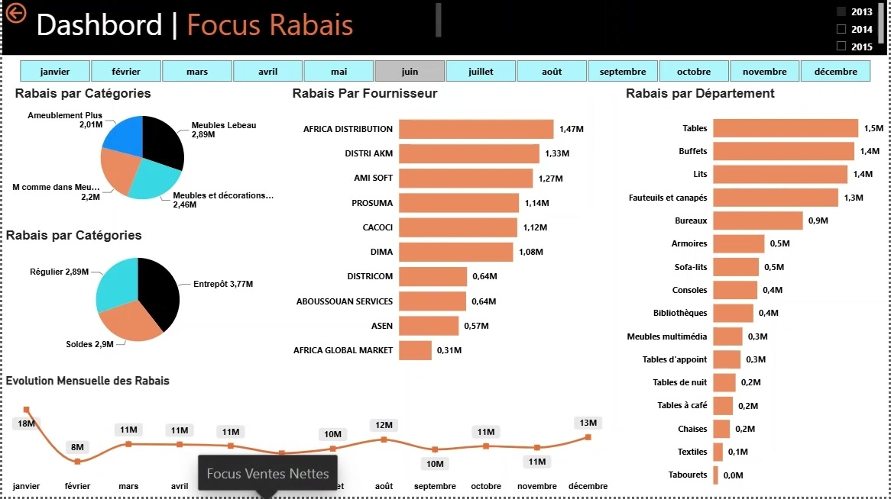
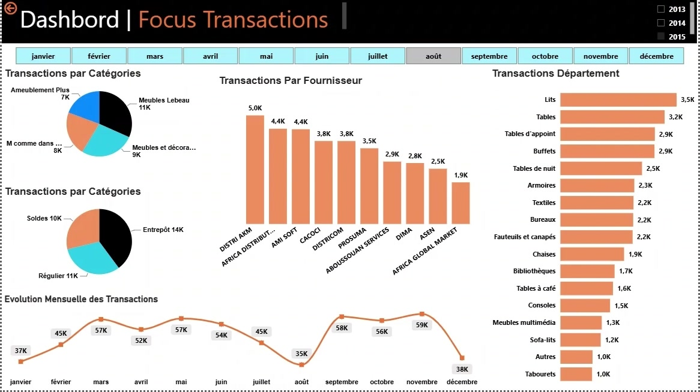
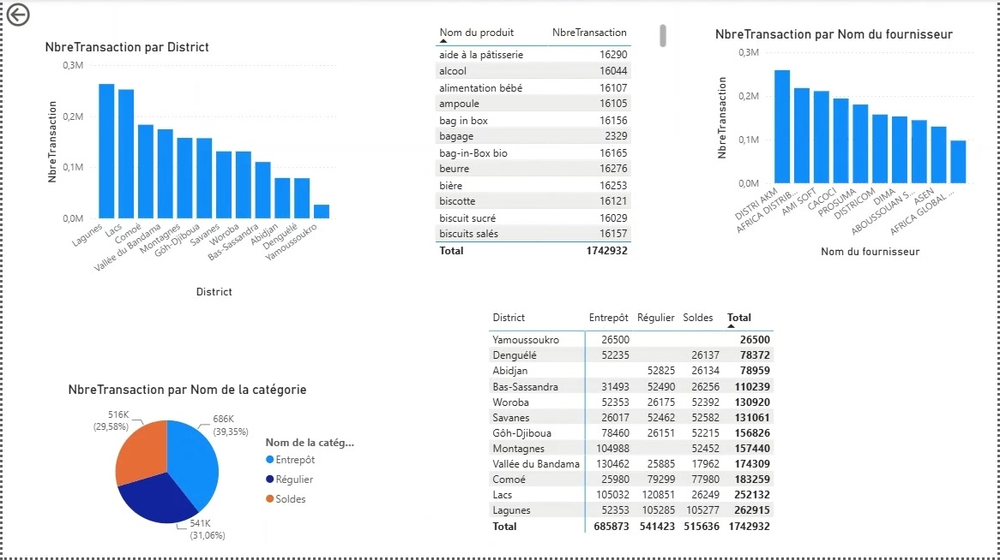
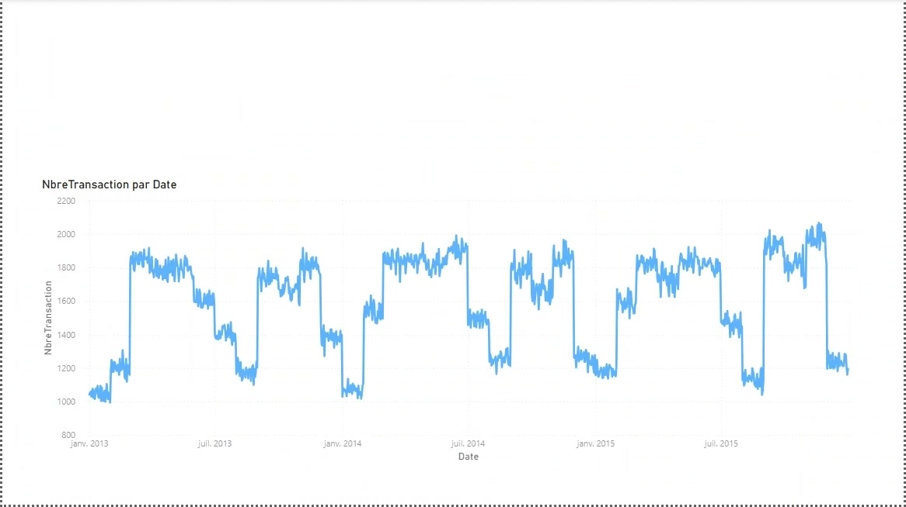
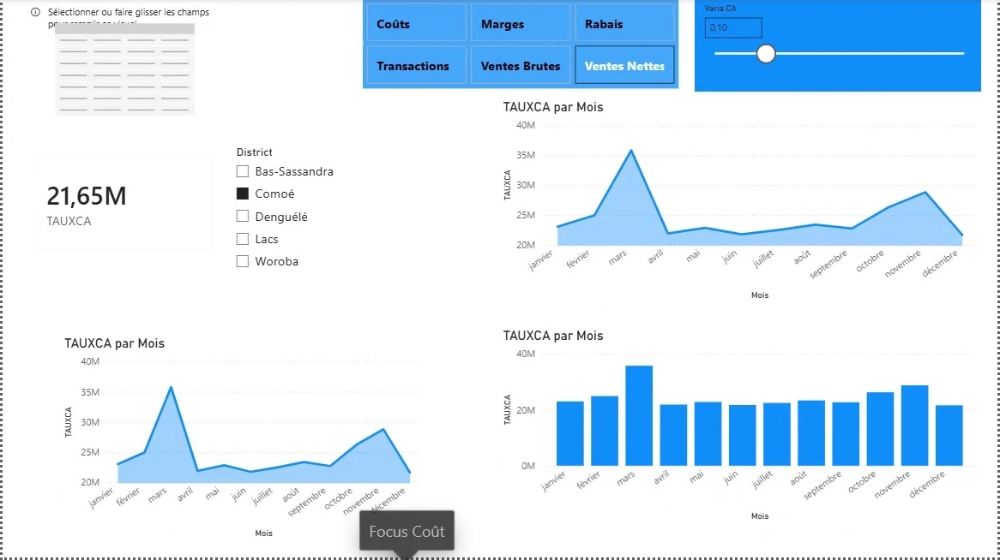

# 📊 Dashboard Ventes – Power BI

Tableau de bord de **pilotage de la performance commerciale** d'un réseau de magasins d'ameublement et de grande distribution, réalisé avec **Power BI Desktop** dans le cadre de ma formation Power BI (PL-300).

Le rapport couvre les ventes de **2013 à 2015**, issues de 36 fichiers mensuels. Il permet d'analyser l'activité par **département produit, fournisseur, catégorie, bannière et district**.

<p align="center">
  
</p>

<p align="center">
  <a href="https://github.com/christsodji/dashboard-ventes-powerbi/raw/main/Dahsbord%20Ventes.pbix"><b>⬇️ Télécharger le rapport (.pbix)</b></a> ·
  <a href="Projet%20Vente.mp4"><b>🎬 Voir la vidéo de démo</b></a>
</p>

---

## 🎯 Objectifs

- Suivre les **KPI commerciaux** : nombre de transactions, ventes brutes, ventes nettes, rabais, coûts, marges, taux et variation du CA.
- Comparer les performances par **département, fournisseur, catégorie, bannière et district**.
- Analyser les **évolutions mensuelles et hebdomadaires**.
- Offrir une **navigation fluide** grâce à des boutons, des titres dynamiques, des segments année / mois et des infobulles personnalisées.

---

## 🖼️ Aperçu des pages

### Focus Ventes Nettes
Une page « Focus » par indicateur, toutes construites sur le même gabarit : un menu pour passer d'un KPI à l'autre, des filtres année / mois, la répartition par catégorie et par bannière, le classement des fournisseurs et des départements, et l'évolution mensuelle ou hebdomadaire.



<table>
  <tr>
    <td width="50%"><b>Focus Ventes Brutes</b><br></td>
    <td width="50%"><b>Focus Marges</b><br></td>
  </tr>
  <tr>
    <td><b>Focus Coûts</b><br></td>
    <td><b>Focus Rabais</b><br></td>
  </tr>
  <tr>
    <td><b>Focus Transactions</b><br></td>
    <td><b>Composition des transactions</b> (district, produit, fournisseur, catégorie)<br></td>
  </tr>
  <tr>
    <td><b>Évolution journalière des transactions</b> (2013 → 2015)<br></td>
    <td><b>Paramètres dynamiques</b> (taux de CA par district, indicateur au choix)<br></td>
  </tr>
</table>

---

## 🧱 Modèle de données

Modèle en **étoile** :

| Type | Tables |
|---|---|
| **Faits** | Ventes mensuelles (`SourcesDeDonnees/Ventes/Ventes_AAAA-MM.xlsx`), combinées dans Power Query |
| **Dimensions** | `DimProduit`, `DimCategorie`, `DimDept`, `DimFournisseurs`, `DimMagasin`, `DimBanniere` |
| **Dates** | `DimDates`, table calculée en DAX, du 01/01/2013 au 31/12/2015 ([code](SourcesDeDonnees/Code%20DAX%20-%20Table%20de%20date.txt)) |
| **Mesures** | Table `Tbl_mesure` : ventes, coûts, marges, rabais, transactions, cumuls, titres dynamiques… |

---

## 🛠️ Compétences mises en œuvre

- **Power Query** : import et combinaison automatique de 36 fichiers Excel, nettoyage, typage
- **Modélisation** : schéma en étoile, relations, table de dates DAX
- **DAX** : mesures de ventes, marges, rabais et coûts, cumuls mensuels / semestriels / annuels, variation du CA, titres et indicateurs dynamiques
- **Interactivité** : paramètres de champs, segments, boutons de navigation, infobulles de page personnalisées
- **Design** : charte graphique homogène, arrière-plans et icônes personnalisés

---

## 📁 Structure du dépôt

```
dashboard-ventes-powerbi/
├── Dahsbord Ventes.pbix        # Rapport Power BI
├── Projet Vente.mp4            # Vidéo de démonstration
├── captures/                   # Captures d'écran et GIF du README
├── SourcesDeDonnees/
│   ├── Ventes/                 # 36 fichiers de ventes mensuels (2013-2015)
│   ├── Dim*.xlsx               # Tables de dimensions
│   └── ...                     # Codes postaux, prix moyens, code DAX
├── Images/                     # Arrière-plans et icônes du rapport
└── Annexes/                    # Supports de la formation Power BI
```

---

## ▶️ Ouvrir le rapport

GitHub ne peut pas afficher un fichier `.pbix` dans le navigateur. Pour l'ouvrir :

1. Clique sur **[Télécharger le rapport](https://github.com/christsodji/dashboard-ventes-powerbi/raw/main/Dahsbord%20Ventes.pbix)**.
2. Ouvre-le avec **[Power BI Desktop](https://www.microsoft.com/fr-fr/power-platform/products/power-bi/desktop)** (gratuit, Windows).
3. Pour actualiser les données, mets à jour les chemins des sources dans *Transformer les données → Paramètres de la source de données*, en pointant vers le dossier `SourcesDeDonnees/`.

---

👤 **Christ Sodji** · [GitHub](https://github.com/christsodji)
